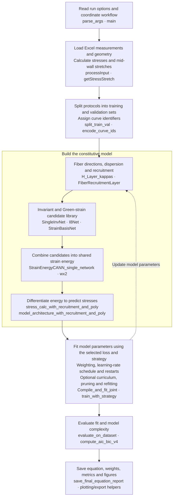

# CANN training

VeinCANN discovers hyperelastic constitutive models for venous tissue from passive inflation biaxial test data. The model fits pressure-diameter (`PD`) and force-length (`FL`) protocols and reports a strain-energy equation with fitted material response plots and diagnostics. The processed data from the previous section can be used as input for `neural_net.py`.

## 1. Structure of the code

- `neural_net.py` trains a physics constrained neural constitutive model for venous tissue. Details about the architecture can be found in section 2.2 of [1].
- The model uses stretch-based invariants, Green-strain polynomial terms, diagonal fiber families, and optional fiber recruitment.
- The final output includes a discovered strain-energy equation and fitted stress-stretch/load response.

The implementation is a single Python script. The flowchart shows the main stages and the functions responsible for each:



The shared energy network uses `I1`, `I2`, `I4f`, `I4s`, `I4el`, `I4smc`, `I8fs`, `E_theta`, and `E_z`. The ordinary invariant subnets each provide seven candidates; `I8Net` provides five without logarithmic terms because `I8fs` can be negative. Green-strain candidates add polynomial and, by default, linear terms.

## 2. Inputs and running

See the [sample data and pre-processing README](<../1.%20Sample%20data%20and%20pre-processing/README.md>) for the Excel input structure, required columns and units, protocol labels, and MAT-to-Excel conversion instructions. Select the processed workbook with `--sample_file <workbook.xlsx>`.

Use `--pd_train_protocols` and `--fl_train_protocols` to select training protocols; any remaining protocols are used for validation.

### Mid-wall stretch calculation

`neural_net.py` calculates stresses and stretches from the workbook before fitting. Circumferential stretch follows Ferruzzi et al. (2013), Eq. (4):

```text
lambda_theta = (loaded_inner_radius + loaded_wall_thickness / 2)
             / (unloaded_inner_radius + unloaded_wall_thickness / 2)
lambda_z = loaded_length / unloaded_length
```

All radius and thickness values are expressed in the same units before taking the ratio.

### Internal model input/output arrays

For each branch, the script builds `X` with shape `(N, 2)` in the order `[lambda_theta, lambda_z]`, a target stress vector of shape `(N,)`, and curve IDs. The Keras stress model receives four `(N, 1)` arrays: `[lambda_theta, lambda_z, branch_flag, curve_id]`, where the branch flag is `0` for PD and `1` for FL and curve IDs are integers. It returns normalized circumferential and axial stresses; reported physical stresses are recovered using `theta_max` and `z_max`.

### Requirements and running

Jugular vein 106 is included in `1. Sample data and pre-processing/sample data`; the environment file is included in this training folder as `environment.yml`. 

Run from the repository root. By default, `--sample_file` points to the included jugular 106 workbook relative to the script; the `SAMPLE_FILE` environment variable can override it. Supply explicit input and output paths for a reproducible run. The example below adapts the original jugular 106 settings to Excel input and mid-wall stretch; it has not been validated as a reproduction of the previous fit:

```bash
python "2. CANN training/neural_net.py" \
  --sample_file "1. Sample data and pre-processing/sample data/JV_VG_106_19Jun20_unloading_data.xlsx" \
  --path_root "4. Evaluation/Fitted_results" \
  --filename jugular_106_midwall \
  --report_label jugular_106 \
  --objective stress \
  --training_mode normal \
  --epochs 6200 --batch_size 32 \
  --recruit_preset medium --recruit_dist lognormal \
  --recruit_shift on --shift_mode inverse \
  --per_curve_recruit on --curve_offset_max 0.30 --curve_offset_l2 5e-4 \
  --curve_weighting equal --circ_weight 2.0 \
  --robust huber --robust_delta 0.5 \
  --theta_tail_gain 1.0 --theta_tail_power 4.0 --theta_tail_stretch_v4 1.65 \
  --z_tail_gain 0.0 --z_tail_power 4.0 \
  --lr 0.01 --lr_schedule plateau --lr_patience 200 \
  --reg L1 --pen 1e-5 \
  --equation_thresh 1e-7 \
  --poly_n_terms 7 \
  --strain_basis_scale auto --nonneg_weights on \
  --i8fs_init 0.1 \
  --n_restarts 5 --seed 125
```

Relative command-line paths are resolved from the working directory where the command is run. For a quick test run, reduce `--epochs` and `--n_restarts`. 

## 3. Hyperparameters and run options

The reference below lists the options accepted by `parse_args`, including I/O and reporting controls. Defaults are parser defaults unless noted; the example above deliberately overrides several of them. Boolean options accept `on`/`off` (also `true`/`false`); `--no_train` is a standalone flag.

- `normal` trains the full library. `curriculum` trains stable/low-order candidates first, then the full library. `curriculum_prune_refit` also prunes weak terms and refits.
- `stress` fits normalized stresses; `stress_hybrid_log` mixes stress and log-stress residuals; `obj6` fits reconstructed pressure/vessel-force residuals and requires unloaded geometry with positive `OD`, `H`, `L` and `OD > 2*H`.
- `--recruit_preset medium` changes the effective initial threshold to `1.20`, lower-bound range to `0.90–1.60`, and upper bound to `1.90`. `early` uses `1.05`, `0.90–1.35`, `1.60`; `late` uses `1.40`, `1.00–1.90`, `2.30`. Use `custom` to retain the individually supplied bounds/threshold.
- `--poly_n_terms 5` selects quadratic/cubic candidates; `7` adds quartics; `10` adds mixed higher-order candidates. `--poly_include_linear on` adds two linear candidates separately. `--use_poly`, `--poly_trainable`, and `--poly_regularizer` are deprecated and ignored; use `--reg`/`--pen` for shared candidate regularization.
- `--init_from` loads compatible weights; retain `curve_vocabulary.json` with the checkpoint for curve mapping. `--freeze_pretrained on` freezes the candidate subnets and `wx2` while recruitment, offsets, angles, and dispersion remain trainable. For fine-tuning, specify learning rate, epochs, and strategy explicitly: the current `--finetune` convenience overrides are conditional on particular incoming values.
- `--equation_thresh` controls reported active terms; `--prune_threshold` controls pruning during the prune/refit strategy. These serve different purposes.

### Input and output paths

| Option            | Default                                                      | Meaning / choices                                                    |
| ----------------- | ------------------------------------------------------------ | -------------------------------------------------------------------- |
| `--sample_file` | `Included jugular 106 workbook (SAMPLE_FILE env override)` | Excel workbook with FL and PD sheets.                                |
| `--path_root`   | `Legacy output directory (override --path_root)`           | Root directory for run outputs.                                      |
| `--filename`    | `'VeinCANN_combined_SingleSample'`                         | Run sub-folder name.                                                 |
| `--folder_name` | `None`                                                     | Inner folder name (defaults to autogenerated with epochs/batch/pen). |

### Training and loss

| Option                   | Default       | Meaning / choices                                                                                                                                                                                    |
| ------------------------ | ------------- | ---------------------------------------------------------------------------------------------------------------------------------------------------------------------------------------------------- |
| `--no_train`           | `False`     | Skip training (kept for symmetry; v3 only supports train=True).                                                                                                                                      |
| `--epochs`             | `2000`      | Epoch count for normal training.                                                                                                                                                                     |
| `--batch_size`         | `32`        | Training batch size.                                                                                                                                                                                 |
| `--reg`                | `'L1'`      | Shared candidate regularization. Choices: L1, L2.                                                                                                                                                    |
| `--pen`                | `1e-05`     | Regularization penalty.                                                                                                                                                                              |
| `--objective`          | `'stress'`  | Training objective: reconstructed pressure/force loads, direct normalized stress, or hybrid stress+log stress. Choices: obj6, stress, stress_hybrid_log.                                             |
| `--log_stress_scale`   | `1.0`       | Physical kPa scale s0 used by stress_hybrid_log: log1p(stress / s0).                                                                                                                                 |
| `--log_loss_weight`    | `0.5`       | Fraction of stress_hybrid_log loss assigned to the log-stress term.                                                                                                                                  |
| `--circ_weight`        | `3.5`       | Loss weight on the circumferential (PD) samples vs. axial (FL).                                                                                                                                      |
| `--tail_weight`        | `0.0`       | Extra sample-weight multiplier for high-stress/high-stretch elbow/tail points.                                                                                                                       |
| `--tail_stress_frac`   | `0.0`       | Activate tail weighting once abs(stress)/max_stress exceeds this fraction (0 disables).                                                                                                              |
| `--theta_tail_stretch` | `0.0`       | Activate circumferential tail weighting once lambda_theta exceeds this value (0 disables).                                                                                                           |
| `--z_tail_stretch`     | `0.0`       | Activate axial tail weighting once lambda_z exceeds this value (0 disables).                                                                                                                         |
| `--tail_width`         | `0.05`      | Sigmoid width for smooth tail/elbow sample weighting.                                                                                                                                                |
| `--lr`                 | `0.01`      | Adam initial learning rate.                                                                                                                                                                          |
| `--lr_schedule`        | `'plateau'` | LR schedule: 'plateau' (ReduceLROnPlateau, adaptive), 'exponential' (decays each step), 'cosine' (CosineDecay from lr to lr_min), 'none' (constant lr). Choices: none, plateau, exponential, cosine. |
| `--lr_decay`           | `0.2`       | Factor used by plateau / exponential schedules (plateau: new_lr = lr * factor; exponential: decay_rate).                                                                                             |
| `--lr_patience`        | `200`       | Epochs without improvement before plateau drops the LR.                                                                                                                                              |
| `--lr_min`             | `1e-05`     | Lower bound on the learning rate (plateau / cosine).                                                                                                                                                 |

### Protocol selection

| Option                   | Default                                  | Meaning / choices                  |
| ------------------------ | ---------------------------------------- | ---------------------------------- |
| `--pd_train_protocols` | `['invivo-5%', 'invivo', 'invivo+5%']` | Test cases (PD) used for training. |
| `--fl_train_protocols` | `['p10', 'p60', 'p100', 'p140']`       | Test cases (FL) used for training. |

### Fiber angles

| Option                     | Default           | Meaning / choices                                                                                                 |
| -------------------------- | ----------------- | ----------------------------------------------------------------------------------------------------------------- |
| `--helical_mode`         | `'independent'` | Fiber angle parameterization. 'symmetric' uses one bounded angle pair +/- alpha. Choices: independent, symmetric. |
| `--helix_angle_init_deg` | `35.0`          | Initial helical fiber angle magnitude in degrees.                                                                 |
| `--helix_angle_min_deg`  | `5.0`           | Minimum helical fiber angle magnitude in degrees for symmetric mode.                                              |
| `--helix_angle_max_deg`  | `85.0`          | Maximum helical fiber angle magnitude in degrees for symmetric mode.                                              |
| `--train_fiber_angles`   | `True`          | Allow helical fiber angle parameters to train (on/off).                                                           |

### Recruitment

| Option                  | Default         | Meaning / choices                                                                                                                                                                                                                                                                         |
| ----------------------- | --------------- | ----------------------------------------------------------------------------------------------------------------------------------------------------------------------------------------------------------------------------------------------------------------------------------------- |
| `--recruit_preset`    | `'medium'`    | Shorthand to set init_threshold + lb/ub bounds together. early=(1.05, 0.90-1.35, ub=1.60), medium=(1.20, 0.90-1.60, ub=1.90), late=(1.40, 1.00-1.90, ub=2.30). Overrides --init_threshold and --recruit_lb_min/_max/_ub_max unless set to 'custom'. Choices: early, medium, late, custom. |
| `--init_threshold`    | `1.4`         | Initial lambda_lb for FiberRecruitmentLayer. Only used when --recruit_preset custom; ignored otherwise (preset overwrites it).                                                                                                                                                            |
| `--init_sharpness`    | `5.0`         | Initial sharpness (tau) of the softplus recruitment transition.                                                                                                                                                                                                                           |
| `--recruit_lb_min`    | `0.9`         | Hard lower bound for learned lambda_lb. Only used when --recruit_preset custom; ignored otherwise.                                                                                                                                                                                        |
| `--recruit_lb_max`    | `2.0`         | Hard upper bound for learned lambda_lb. Only used when --recruit_preset custom; ignored otherwise.                                                                                                                                                                                        |
| `--recruit_ub_max`    | `2.3`         | Hard upper bound for learned lambda_ub. Only used when --recruit_preset custom; ignored otherwise.                                                                                                                                                                                        |
| `--use_recruitment`   | `True`        | Enable the FiberRecruitmentLayer (on/off).                                                                                                                                                                                                                                                |
| `--recruit_dist`      | `'lognormal'` | Slack-stretch distribution across the fiber population: beta (compact support, flexible shape) or shifted truncated lognormal (right-skewed, harder floor at lambda_lb). Choices: beta, lognormal.                                                                                        |
| `--recruit_shift`     | `'on'`        | Enable branch-aware lambda_lb shift driven by the held companion stretch (PD samples shift with lambda_z, FL with lambda_theta). Choices: on, off.                                                                                                                                        |
| `--shift_mode`        | `'inverse'`   | When --recruit_shift on: 'direct' = lambda_lb * companion/ref (higher companion → later recruitment), 'inverse' = lambda_lb * ref/companion (higher companion → earlier recruitment). Choices: direct, inverse.                                                                         |
| `--per_curve_recruit` | `'on'`        | Enable per-curve learned bounded lambda_lb offsets. Choices: on, off.                                                                                                                                                                                                                     |
| `--curve_offset_max`  | `0.3`         | Max absolute delta lambda_lb per curve when --per_curve_recruit on.                                                                                                                                                                                                                       |
| `--curve_offset_l2`   | `0.0005`      | L2 regularizer on the raw per-curve offset weights.                                                                                                                                                                                                                                       |

### Strain-energy candidates

| Option                    | Default    | Meaning / choices                                                                                                                                                                                             |
| ------------------------- | ---------- | ------------------------------------------------------------------------------------------------------------------------------------------------------------------------------------------------------------- |
| `--use_poly`            | `True`   | Deprecated compatibility flag. Ignored: Green-strain candidates are always part of the single shared network.                                                                                                 |
| `--poly_n_terms`        | `7`      | Number of polynomial basis terms. Choices: 5, 7, 10.                                                                                                                                                          |
| `--poly_trainable`      | `True`   | Deprecated compatibility flag. Ignored: strain candidates are always trainable through the shared network.                                                                                                    |
| `--poly_regularizer`    | `0.001`  | Deprecated compatibility flag. Ignored: use --reg/--pen for shared candidate regularization.                                                                                                                  |
| `--poly_include_linear` | `True`   | Add linear E_theta and E_z basis terms to the polynomial layer (on/off). Linear I4f/I4s/I4el/I4smc terms already exist as the first weight per family inside each SingleInvNet, so they are always trainable. |
| `--strain_basis_scale`  | `'auto'` | Scale Green-strain basis columns before the shared wx2 layer. 'auto' divides each strain candidate by its training max-abs value. Choices: auto, none.                                                        |
| `--strain_scale_floor`  | `1e-06`  | Minimum denominator for auto strain-basis scaling.                                                                                                                                                            |
| `--nonneg_weights`      | `True`   | Constrain invariant-subnet, I8fs, W_ANN, and polynomial weights to be >= 0 (on/off).                                                                                                                          |
| `--i8fs_init`           | `0.1`    | Initial value for I8fs quadratic and exp-quadratic cross-fiber terms.                                                                                                                                         |

### Reproducibility and reporting

| Option                | Default                        | Meaning / choices                                                                                 |
| --------------------- | ------------------------------ | ------------------------------------------------------------------------------------------------- |
| `--seed`            | `45 (FIT_SEED env override)` | Random seed for repeatable initialization.                                                        |
| `--verbose`         | `1`                          | Keras fit verbosity: 0=silent, 1=progress bar, 2=one line per epoch. Choices: 0, 1, 2.            |
| `--equation_thresh` | `0.001`                      | Absolute effective-weight threshold for listing a term as surviving in the final-equation report. |
| `--report_label`    | `None`                       | Label used in the final-equation report title (defaults to the data source folder/file name).     |

### Curve weighting and robust residuals

| Option                      | Default     | Meaning / choices                                                                                                                       |
| --------------------------- | ----------- | --------------------------------------------------------------------------------------------------------------------------------------- |
| `--curve_weighting`       | `'point'` | 'equal' = each physical PD/FL curve contributes equally; 'point' = each sample contributes equally (v3 default). Choices: equal, point. |
| `--robust`                | `'mse'`   | Residual kernel for the stress/obj6 objective. Choices: mse, huber, charbonnier.                                                        |
| `--robust_delta`          | `0.5`     | Huber transition / Charbonnier eps stand-in.                                                                                            |
| `--theta_tail_gain`       | `2.0`     | Polynomial tail gain on PD residuals: w *= 1 + gain * max(lambda_theta - theta_tail_stretch, 0)^power.                                  |
| `--theta_tail_power`      | `4.0`     | PD polynomial-tail exponent.                                                                                                            |
| `--theta_tail_stretch_v4` | `None`    | Deprecated alias for the v4 polynomial PD tail onset. If set, overrides --theta_tail_stretch for the polynomial tail only.              |
| `--z_tail_gain`           | `1.5`     | FL polynomial-tail gain.                                                                                                                |
| `--z_tail_power`          | `4.0`     | FL polynomial-tail exponent.                                                                                                            |
| `--z_tail_stretch_v4`     | `1.4`     | Deprecated alias for the v4 polynomial FL tail onset. If set, overrides --z_tail_stretch for the polynomial tail only.                  |

### Training strategy and restarts

| Option                    | Default      | Meaning / choices                                                                                                                                                                             |
| ------------------------- | ------------ | --------------------------------------------------------------------------------------------------------------------------------------------------------------------------------------------- |
| `--training_mode`       | `'normal'` | Training strategy. curriculum: low-order terms only first, then full library. curriculum_prune_refit: also prunes weak terms and refits. Choices: normal, curriculum, curriculum_prune_refit. |
| `--epochs_phase1`       | `1500`     | Stable/low-order phase epoch count.                                                                                                                                                           |
| `--epochs_phase2`       | `3000`     | Full-library phase epoch count.                                                                                                                                                               |
| `--epochs_refit`        | `1000`     | Pruned-library refit epoch count.                                                                                                                                                             |
| `--prune_threshold`     | `0.001`    | Effective abs(w_sub * w_ann) (scaled by mean abs(basis)) below which a candidate is zeroed at the start of phase 3.                                                                           |
| `--early_stop_patience` | `1000`     | Epochs of no improvement before EarlyStopping restores best weights.                                                                                                                          |
| `--n_restarts`          | `1`        | Number of independent restarts (best by val_loss when available, otherwise by training weighted loss).                                                                                        |

### Warm start and fine-tuning

| Option                  | Default   | Meaning / choices                                                                                                                                                                      |
| ----------------------- | --------- | -------------------------------------------------------------------------------------------------------------------------------------------------------------------------------------- |
| `--init_from`         | `None`  | Path to a final_weights.h5 file produced by a prior run. Loaded before training; enables warm-start fine-tuning.                                                                       |
| `--freeze_pretrained` | `'off'` | When --init_from is set: freeze the invariant subnet weights (w*_*) and the final wx2 layer. Recruitment, per-curve offsets, helix angles, and kappa stay trainable. Choices: on, off. |
| `--finetune`          | `'off'` | Convenience flag: when on, sets sensible fine-tune defaults (lr=1e-3, n_restarts=1, training_mode=normal, epochs=500) unless the user explicitly overrode them. Choices: on, off.      |

## 4. Output structure

Each run saves results under `<path_root>/<filename>/<folder_name>/all/`, with raw-data plots in the parent run folder.

Use `--folder_name` to set the inner run folder explicitly. Otherwise it is generated as `single_network_obj6_train_<epochs>_<batch_size>_<reg><pen>_poly<poly_n_terms>_scale-<strain_basis_scale>_all_protocols_train`. The literal `obj6` in that generated name is used even for other objectives. Use distinct run names or folder names to keep results from separate runs.

Key outputs:

| File(s)                                              | Contents                                                                                                                    |
| ---------------------------------------------------- | --------------------------------------------------------------------------------------------------------------------------- |
| `metrics.txt`                                      | Readable summary of hyperparameters, training protocols, fit metrics, and AIC/BIC.                                          |
| `fit_metrics.csv`                                  | One-row table of the main fit metrics and selected AIC/BIC values.                                                          |
| `final_equation.txt`                               | Discovered strain-energy equation terms above the reporting threshold.                                                      |
| `trained_weights.txt`                              | Fitted model weights in readable form.                                                                                      |
| `final_weights.weights.h5`                         | Saved Keras weights for warm-start or fine-tuning; falls back to `final_weights.h5` for older Keras if needed.            |
| `curve_vocabulary.json`                            | Ordered protocol names associated with integer curve IDs; saved alongside the checkpoint.                                   |
| `Training_circumferential.*`, `Training_axial.*` | Model fit plots for PD and FL data.                                                                                         |
| `publication_figure.*`, `publication_figure_2.*` | Combined publication-style fit figures; the second uses protocol colors and a legend.                                       |
| `Plot_loss_joint_all.pdf`                          | Training-loss history.                                                                                                      |
| `per_curve_metrics.csv`                            | Training-curve branch, curve ID, point count, R², and RMSE.                                                                |
| `term_importance.csv`, `active_terms.csv`        | Candidate term importance and the subset meeting `equation_thresh`.                                                       |
| `learned_recruitment.csv`                          | Per-family recruitment bounds, distribution parameters, transition sharpness, and reference stretches.                      |
| `learned_curve_offsets.csv`                        | Per-curve/per-family recruitment offsets; empty when offsets are disabled.                                                  |
| `shape_metrics.csv`                                | Post-fit shape diagnostics, including slope and roughness measures.                                                         |
| `aic_bic.csv`                                      | Training-set AIC/BIC, residual sums, observation counts, and effective parameter counts for pooled and individual branches. |
| `recruitment_curves.*`, `recruitment_combined.*` | Recruitment plots for enabled recruitment layers.                                                                           |

Branch-specific plots require that branch's data; `Validation_circumferential.*` and/or `Validation_axial.*` are added when held-out protocols exist. Recruitment reports/plots require recruitment to be enabled, and checkpoint/figure saving is subject to the script's export handlers.

The script also writes headerless `CANNmodel_<filename>_loads_Pd.xlsx`, `_loads_Fl.xlsx`, `_stress_Pd.xlsx`, and `_stress_Fl.xlsx` for legacy plotting when the required load columns are available.

## References

1. Bazzi, M., Adil, D., Mays, G., Kuhl, E., Breuer, C.K., Humphrey, J.D., Marsden, A.L.: Data-Driven Discovery of a Hyperelastic Strain-Energy Function for Veins Using Constitutive Artificial Neural Networks. *arXiv preprint* arXiv:2610.15229 (2026). [arXiv](https://arxiv.org/abs/2610.15229).
2. Ferruzzi, J., Bersi, M.R., Humphrey, J.D.: Biomechanical phenotyping of central arteries in health and disease: Advantages of and methods for murine models. *Annals of Biomedical Engineering* **41**(7), 1311–1330 (2013). [DOI](https://doi.org/10.1007/s10439-013-0799-1).
