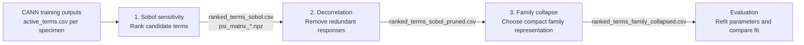

# Model selection

This directory contains the population-level model-selection pipeline for
vein-CANN. It converts the overcomplete strain-energy library learned during
CANN training into a compact, interpretable candidate strain-energy function
(SEF).

The pipeline has three ordered stages:

1. [Sensitivity analysis](<1.%20Sensitivity%20analysis/README.md>) ranks terms
   by variance-based Sobol sensitivity across a specimen cohort.
2. [Decorrelation](<2.%20Decorrelation/README.md>) removes lower-ranked terms
   whose evaluated responses are nearly redundant with retained terms.
3. [Family collapse](<3.%20Family%20collapse/README.md>) limits the number of
   alternative response shapes retained within each constitutive family.

The result is a candidate equation structure, not a final set of material
parameters. The selected equation must be refit and assessed using the
[evaluation workflow](<../4.%20Evaluation/README.md>).

## Pipeline



Each stage answers a different question:

| Stage | Question | Main decision |
| --- | --- | --- |
| Sensitivity | Which terms influence the sampled strain-energy response? | Sobol regime, stretch grids, and cohort definition |
| Decorrelation | Which influential terms add a numerically distinct response? | Correlation threshold and grid-combination rule |
| Family collapse | Which alternative shapes should represent each mechanism? | Family cap, rank tie tolerance, and simplicity preference |
| Evaluation | Does the compact equation fit the measured stresses with admissible parameters? | LHS/refinement settings and fit criteria |

No individual stage is sufficient on its own. A sensitive term can be
redundant, a decorrelated set can remain structurally overcomplete, and a
compact equation can still fit the experimental data poorly.

## Directory structure

```text
3. Model Selection/
├── README.md
├── 1. Sensitivity analysis/
│   ├── README.md
│   ├── requirements.txt
│   └── sobol_sensitivity_analysis.py
├── 2. Decorrelation/
│   ├── README.md
│   ├── requirements.txt
│   └── decorrelate_sobol_terms.py
└── 3. Family collapse/
    ├── README.md
    ├── requirements.txt
    └── collapse_term_families.py
```

Generated `results/` directories are not required to run the code and should
be treated as analysis outputs rather than source files.

## Required training outputs

The sensitivity stage operates on a cohort root whose immediate child
directories represent specimens. It searches recursively within each specimen
directory for `active_terms.csv`:

```text
training_outputs/
├── specimen_01/
│   └── .../active_terms.csv
├── specimen_02/
│   └── .../active_terms.csv
└── specimen_03/
    └── .../active_terms.csv
```

The training script in [`2. CANN training`](<../2.%20CANN%20training/README.md>)
writes this file. Required columns are:

| Column | Meaning |
| --- | --- |
| `group` | `invariant` or `strain` |
| `inv` | Invariant identifier, or `strain` for Green-strain terms |
| `term` | Candidate response shape |
| `w_sub` | Candidate-subnetwork weight |
| `w_ann` | Shared strain-energy-layer weight |

All specimens analyzed as one cohort should use the same candidate library,
strain-basis configuration, term labels, and active-term reporting threshold.
The default clean library contains 56 candidates when seven Green-strain
polynomial terms and the two linear Green-strain terms are enabled.

## Environment

Python 3.10 or later is recommended. The stages use NumPy, pandas, SALib, and
optionally Matplotlib for the decorrelation heatmap. From the repository root:

```bash
python -m venv .venv-model-selection
source .venv-model-selection/bin/activate
python -m pip install \
  -r "3. Model Selection/1. Sensitivity analysis/requirements.txt" \
  -r "3. Model Selection/2. Decorrelation/requirements.txt" \
  -r "3. Model Selection/3. Family collapse/requirements.txt"
```

Using a separate model-selection environment avoids coupling these scripts to
the older TensorFlow versions that may be required to reproduce a historical
CANN training run.

## Complete example

Run all commands from the repository root. Replace
`path/to/training_outputs` with the cohort containing the trained specimen
folders.

### 1. Sensitivity analysis

```bash
python "3. Model Selection/1. Sensitivity analysis/sobol_sensitivity_analysis.py" \
  --cohort ALL_VEINS="path/to/training_outputs" \
  --out_root "3. Model Selection/1. Sensitivity analysis/results" \
  --sobol_N 4096 \
  --primary_regime normalized_cohort \
  --loo \
  --top_k 15 \
  --poly_n_terms 7 \
  --poly-include-linear
```

This creates the cohort folder:

```text
3. Model Selection/1. Sensitivity analysis/results/ALL_VEINS/
```

Its principal outputs are the unified Sobol ranking and the physiological and
extended-grid basis matrices.

### 2. Decorrelation

```bash
python "3. Model Selection/2. Decorrelation/decorrelate_sobol_terms.py" \
  --sensitivity_dir "3. Model Selection/1. Sensitivity analysis/results/ALL_VEINS" \
  --out_dir "3. Model Selection/2. Decorrelation/results/ALL_VEINS" \
  --rank_col mean_ST_rank_primary \
  --corr_threshold 0.98 \
  --corr_combine max \
  --max_terms 25 \
  --make_plot
```

The retained term table is:

```text
3. Model Selection/2. Decorrelation/results/ALL_VEINS/ranked_terms_sobol_pruned.csv
```

### 3. Family collapse

```bash
python "3. Model Selection/3. Family collapse/collapse_term_families.py" \
  --input "3. Model Selection/2. Decorrelation/results/ALL_VEINS/ranked_terms_sobol_pruned.csv" \
  --out_dir "3. Model Selection/3. Family collapse/results/ALL_VEINS" \
  --rank_col mean_ST_rank_primary \
  --max_shapes_per_invariant 1 \
  --max_shapes_per_strain_family 1 \
  --prefer_simple_shapes \
  --tie_tolerance 5
```

The final candidate equation table is:

```text
3. Model Selection/3. Family collapse/results/ALL_VEINS/ranked_terms_family_collapsed.csv
```

Pass this CSV to the evaluation script as `--ranked_terms`, and set `--ks` to
the number of retained rows:

```bash
python "4. Evaluation/pure_sedf_nnls_refit_per_animal_fung.py" \
  --animal_root "path/to/training_outputs" \
  --ranked_terms "3. Model Selection/3. Family collapse/results/ALL_VEINS/ranked_terms_family_collapsed.csv" \
  --out_root "4. Evaluation/refit_results/ALL_VEINS_candidate" \
  --ks 8 \
  --lhs_samples 4096 \
  --refine_top_k 1 \
  --make_plots
```

Replace `--ks 8` with the actual number of rows in the selected CSV.

## Default analysis choices

The example uses the clean pipeline defaults that were promoted from the
current sensitivity framework:

| Choice | Default/example value | Effect |
| --- | --- | --- |
| Sobol base sample size | `4096` | Controls Monte Carlo/Sobol resolution |
| Primary Sobol regime | `normalized_cohort` | Uses normalized basis columns and cohort coefficient variability |
| Physiological grid | `lambda_theta=0.80–1.60`, `lambda_z=1.00–1.40` | Main selection domain |
| Extended grid | `lambda_theta=0.30–2.10`, `lambda_z=1.00–1.60` | Ranking and redundancy robustness domain |
| Correlation threshold | `0.98` | Drops a term when combined `abs(rho) >= 0.98` |
| Grid correlation rule | `max` | Treats redundancy on either grid as sufficient for removal |
| Maximum decorrelated terms | `25` | Upper limit before family collapse |
| Shapes per family | `1` | Produces one representative per scalar family by default |
| Simplicity rank tolerance | `5` | Allows a simpler shape to replace the best-ranked shape within the tie band |

These values are explicit analysis assumptions, not universal constants. The
stage-specific READMEs describe the available alternatives and their
interpretation.

## Cohort strategy

Use one `--cohort` for a population-level equation shared across all included
veins. Use multiple cohort definitions when the scientific question requires
separate anatomical models:

```bash
--cohort NATIVE_IVC="path/to/ivc_outputs" \
--cohort JUGULAR="path/to/jugular_outputs" \
--cohort SAPHENOUS="path/to/saphenous_outputs"
```

The sensitivity script writes one output subdirectory per cohort. Run
decorrelation and family collapse separately for each output subdirectory.
Do not combine cohort rankings after the sensitivity stage without defining a
new, documented aggregation rule.

## Output contracts

| Stage | Required downstream files | Audit and diagnostic files |
| --- | --- | --- |
| Sensitivity | `ranked_terms_sobol.csv`, `psi_matrix_physio.npz`, `psi_matrix_extended.npz` | Per-regime indices, leave-one-out stability, reduced sets, summary |
| Decorrelation | `ranked_terms_sobol_pruned.csv` | Five correlation matrices, pruning log, summary, optional heatmap |
| Family collapse | `ranked_terms_family_collapsed.csv` | Family-collapse log and summary |

Keep the audit files with each reported analysis. The final CSV alone does not
record why other terms were removed.

## Robustness checks

At minimum, examine:

- Sobol rank consistency across the four coefficient regimes and both grids;
- leave-one-specimen-out rank stability;
- retained terms at correlation thresholds such as `0.95`, `0.98`, and `0.99`;
- family selections with simplicity tie tolerances such as `0`, `2`, and `5`;
- the effect of any protected or blocked terms; and
- refit accuracy and parameter admissibility of the final equation.

Optional family mergers—helical `I4f/I4s` merging or direction-matched
strain/invariant merging—are disabled by default. Their assumptions are
documented in the family-collapse README and must be justified when enabled.

## Reproducibility checklist

Record the following with every selected equation:

- repository commit;
- specimen names and cohort definition;
- training configuration and active-term threshold;
- candidate-library and Green-strain settings;
- complete command for each stage;
- random seed and Sobol sample size;
- stretch-grid bounds;
- primary Sobol regime and rank column;
- decorrelation threshold and combination rule;
- protected, blocked, or quota-constrained terms;
- family caps, tie tolerance, and any optional family mergers; and
- evaluation/refit configuration and final fit metrics.

Model selection should be rerun when the training library, specimen cohort,
active-term threshold, or constitutive parameterization changes.
